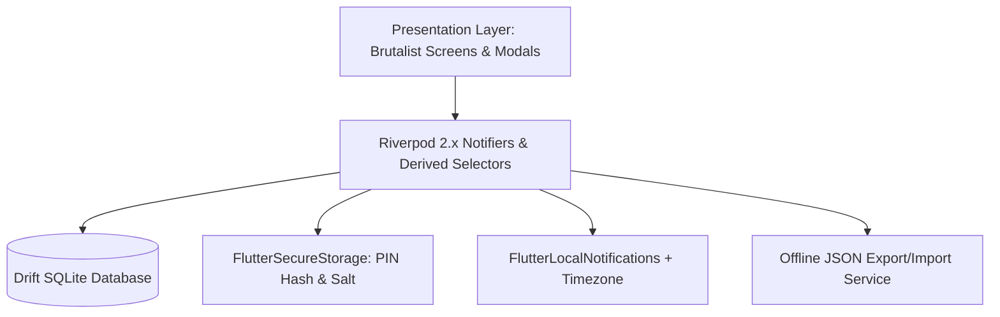

# Monance Mobile — Foolproof Technical & Architectural Specification

> **Package Name:** `monance_mobile`  
> **Target Platform:** Cross-Platform Mobile (Android & iOS)  
> **Tech Stack:** Flutter 3.x (Dart 3.x)  
> **State Management:** Flutter Riverpod 2.x (`NotifierProvider` / `AsyncNotifierProvider` / `StreamProvider`)  
> **Database & Storage:** Drift (Type-Safe SQLite) + `FlutterSecureStorage`  
> **Connectivity:** **100% Offline / Zero Network Access**  
> **Design Philosophy:** Brutalist Monochrome (`0px` border radius, bundled `Space Grotesk` font, WCAG AAA contrast)

---

## 1. Executive Summary & Core Mandate

**Monance Mobile** is a standalone, local-first personal finance mobile application that replicates the complete business logic, financial calculations, and brutalist monochrome UI of the Monance web application (`src/`), while operating **100% offline using local device storage**.

### 1.1 Fundamental Constraint: Zero Network Access
1. **No Internet Permissions:**
   - Omit `<uses-permission android:name="android.permission.INTERNET"/>` from `android/app/src/main/AndroidManifest.xml` (only the debug/profile manifests used by Flutter's local VM service during `flutter run` may retain what Flutter requires for hot-reload).
   - No network client packages (`dio`, `http`) or remote API endpoints (`/api/sync`, `/api/settings`, `/api/auth/*`, `/api/hangouts`) may exist in the codebase.
2. **Offline Asset Bundling (Trap Fix — No Runtime Font Fetching):**
   - **Do NOT use `google_fonts` runtime HTTP fetching**, which throws unhandled `SocketException` errors when offline.
   - Bundle `SpaceGrotesk-Regular.ttf`, `SpaceGrotesk-Medium.ttf`, `SpaceGrotesk-SemiBold.ttf`, and `SpaceGrotesk-Bold.ttf` directly inside `assets/fonts/` and register the `SpaceGrotesk` font family in `pubspec.yaml`.
3. **Local ACID Persistence:**
   - All user settings, daily records, expenses, recurring monthly bills, categories, goal milestones, and hangout sessions are persisted locally in **Drift (SQLite)**.
   - Security credentials (PIN hash, cryptographic salt, biometric toggle) are stored in hardware-backed **`FlutterSecureStorage`**.

---

## 2. Legacy `MonanceMobile` Migration & Cleanup Checklist

When applying this specification to the existing `MonanceMobile` repository, the following legacy online/prototype files and discrepancies **must be removed or replaced** to prevent compiler errors and architectural drift:

### 2.1 Files to Delete Completely
- `lib/core/constants/api_constants.dart` (remote server URLs & token keys)
- `lib/core/network/api_client.dart` (Dio HTTP client & interceptors)
- `lib/services/auth_service.dart` (remote `/api/auth/*` calls)
- `lib/services/sync_service.dart` (remote `/api/sync` & `/api/settings` calls)
- `lib/providers/auth_provider.dart` (remote user session state)
- `lib/models/user_model.dart` (remote MongoDB user model)
- `lib/views/auth/login_view.dart` & `lib/views/auth/register_view.dart` (replaced by optional local `PinLockScreen`)
- `lib/views/goal/goal_view.dart` (merged into `DashboardView`'s `GoalWidget` to match the web app's 5-tab layout)

### 2.2 Known Audit Bugs Resolved by This Spec
| Audit ID | Legacy Bug in Prototype | Foolproof Resolution in This Spec |
| :--- | :--- | :--- |
| **AUDIT-001** | Logging or deleting a wallet expense directly mutated `settings.currentBalance`, causing double deductions and permanent balance loss on Clear Day. | `settings.currentBalance` is an **invariant base reserve** modified *only* via `AddMoneyModal` or Goal Archiving/Undo. Live wallet balance is dynamically computed via `derivedWalletBalanceProvider`. |
| **AUDIT-002** | Mobile used `'daily'` / `'wallet'` while Web used `'allowance'` / `'balance'`. | Standardized strictly on `'allowance'` and `'balance'` across all Drift tables, models, and JSON backups, with backward-compatible deserialization mapping `'daily' -> 'allowance'` and `'wallet' -> 'balance'`. |
| **AUDIT-003** | `isDeleted` flag omitted or mishandled during serialization. | Explicitly persisted in `DailyRecordsTable` and `HangoutSessionsTable` and respected by all calculation selectors. |
| **AUDIT-008** | `GoalView` summed `remainingDailyAllowance` across all days, causing non-allowance days (`startingMoney == 0`) to subtract wallet expenses from goal savings and ignoring `goalStartDate`. | Goal savings strictly filter for allowance days (`startingMoney > 0`) where `date >= goalStartDate` and subtract *only* `'allowance'` expenses. |

---

## 3. Architecture & Technology Stack



### 3.1 Required `pubspec.yaml` Dependencies
```yaml
dependencies:
  flutter:
    sdk: flutter

  # State Management
  flutter_riverpod: ^2.6.1

  # Local Relational Database (SQLite)
  drift: ^2.22.0
  sqlite3_flutter_libs: ^0.5.26
  path_provider: ^2.1.5
  path: ^1.9.0

  # Offline Security & Biometrics
  flutter_secure_storage: ^9.2.2
  local_auth: ^2.3.0
  crypto: ^3.0.6

  # Formatting & Utilities
  intl: ^0.20.1
  uuid: ^4.5.1

  # Offline Local Notifications & Timezone Support
  flutter_local_notifications: ^18.0.1
  timezone: ^0.10.0

  # Offline JSON Backup & Restore
  file_picker: ^8.1.4
  share_plus: ^10.1.2

dev_dependencies:
  flutter_test:
    sdk: flutter
  flutter_lints: ^4.0.0
  drift_dev: ^2.22.0
  build_runner: ^2.4.13

flutter:
  uses-material-design: true
  fonts:
    - family: SpaceGrotesk
      fonts:
        - asset: assets/fonts/SpaceGrotesk-Regular.ttf
          weight: 400
        - asset: assets/fonts/SpaceGrotesk-Medium.ttf
          weight: 500
        - asset: assets/fonts/SpaceGrotesk-SemiBold.ttf
          weight: 600
        - asset: assets/fonts/SpaceGrotesk-Bold.ttf
          weight: 700
```

---

## 4. Design System & Brutalist UI Guidelines

Monance uses a sharp, high-contrast monochrome aesthetic matching `src/app/globals.css`.

### 4.1 Strict Brutalist Rules
1. **`0px` Border Radius Everywhere:**
   - Every `Card`, `Container`, `TextField`, `ElevatedButton`, `OutlinedButton`, `Dialog`, `BottomSheet`, `SnackBar`, and `Checkbox` **must** use `BorderRadius.zero`.
   - Replace all legacy `BorderRadius.circular(12)` and `BorderRadius.circular(16)` in `AppTheme` with `BorderRadius.zero`.
2. **Color Tokens (WCAG AA/AAA Compliant):**

| Token | Dark Theme (Default) | Light Theme | Usage |
| :--- | :--- | :--- | :--- |
| `bgPrimary` | `#111111` | `#F5F5F5` | Scaffold background |
| `bgSecondary` | `#1C1C1C` | `#E9E9E9` | Input fields, gauges, recessed boxes |
| `bgCard` | `#1A1A1A` | `#FFFFFF` | Card surfaces |
| `bgCardHover` | `#242424` | `#F0F0F0` | Active / pressed surface |
| `borderColor` | `#333333` | `#D0D0D0` | Default `1px` sharp structural border |
| `borderFocus` | `#888888` | `#555555` | Focused input border (`1.5px`) |
| `borderStrong` | `#555555` | `#999999` | Emphasized card/button border |
| `textPrimary` | `#F2F2F2` | `#141414` | Primary headings & amounts |
| `textSecondary` | `#A0A0A0` | `#404040` | Labels & subtitles |
| `textMuted` | `#6B6B6B` | `#6B6B6B` | Disabled text & footers |
| `colorSuccess` | `#10B981` | `#059669` | Saved money, On Track, Paid bill |
| `colorDanger` | `#EF4444` | `#DC2626` | Overspent, Overdue bill, Delete action |
| `colorWarning` | `#F59E0B` | `#D97706` | High Burn rate, Due Today / Upcoming |
| `colorInfo` | `#3B82F6` | `#2563EB` | Neutral badges & default accents |

3. **Default Categories (`default_categories.dart`):**
   Matches `src/lib/constants.js` verbatim:
   - `Food`: `#EAB308`
   - `Transport`: `#3B82F6`
   - `Study`: `#6366F1`
   - `Shopping`: `#EF4444`
   - `Hangout`: `#A855F7`
   - `Bills`: `#06B6D4`
   - `Other`: `#64748B`
4. **Privacy Mode Masking:**
   - Toggled via the eye icon in the top header bar and persisted in `SettingsTable.privacyMode`.
   - When `privacyMode == true`:
     - Monetary values render as `'<currencySymbol> ***.**'` (e.g., `'₱ ***.**'`).
     - Percentages in gauges render as `'*** %'`.
     - Estimated days and pacing status render as `'***'`.

---

## 5. Drift Relational Database Schema

All monetary amounts are stored as **integers in cents/centavos** (`100` cents = `1.00` unit of currency).

### 5.1 Foolproof Schema Rules (Preventing Compile & FK Errors)
1. **No Non-Const `Constant(DateTime.now())`:** Drift table definitions require compile-time constants inside `withDefault(const Constant(...))`. For dynamic timestamps, always use `clientDefault(() => DateTime.now().millisecondsSinceEpoch)`.
2. **No Strict Foreign Key on `ExpensesTable.category`:** Deleting a custom category in Settings must **not** delete or corrupt historical expenses that used that category. `ExpensesTable.category` is a plain `TextColumn`; when rendering a category whose name is no longer in `CategoriesTable`, `getCategoryColor()` falls back to `#64748B`.
3. **Single-Row `SettingsTable`:** `SettingsTable` always uses fixed primary key `id = 1`.

### 5.2 Complete Drift Table Definitions (`lib/core/database/tables.dart`)

```dart
import 'package:drift/drift.dart';

class SettingsTable extends Table {
  IntColumn get id => integer().withDefault(const Constant(1))();
  IntColumn get defaultAllowance => integer().withDefault(const Constant(0))(); // cents (0..99999900)
  IntColumn get goalAmount => integer().withDefault(const Constant(0))();       // cents (0..9999999900)
  IntColumn get currentBalance => integer().withDefault(const Constant(0))();   // cents (0..9999999900)
  TextColumn get goalStartDate => text().nullable()();                          // YYYY-MM-DD or null
  TextColumn get currencyCode => text().withDefault(const Constant('PHP'))();
  TextColumn get currencySymbol => text().withDefault(const Constant('₱'))();
  TextColumn get lastBillsMonth => text().nullable()();                         // YYYY-MM
  BoolColumn get themeIsDark => boolean().withDefault(const Constant(true))();
  BoolColumn get privacyMode => boolean().withDefault(const Constant(false))();
  BoolColumn get billNotificationsEnabled => boolean().withDefault(const Constant(false))();
  IntColumn get updatedAt => integer().clientDefault(() => DateTime.now().millisecondsSinceEpoch)();

  @override
  Set<Column> get primaryKey => {id};
}

class DailyRecordsTable extends Table {
  TextColumn get date => text()(); // PK: YYYY-MM-DD
  TextColumn get title => text().withDefault(const Constant('school'))();
  IntColumn get startingMoney => integer().withDefault(const Constant(0))(); // cents
  BoolColumn get isDeleted => boolean().withDefault(const Constant(false))();
  IntColumn get updatedAt => integer().clientDefault(() => DateTime.now().millisecondsSinceEpoch)();

  @override
  Set<Column> get primaryKey => {date};
}

class ExpensesTable extends Table {
  TextColumn get id => text()(); // UUID or 'hangout-<sessionId>-<expId>'
  TextColumn get date => text().references(DailyRecordsTable, #date, onDelete: KeyAction.cascade)();
  TextColumn get title => text().withLength(min: 1, max: 100)();
  IntColumn get amount => integer()(); // cents (> 0)
  TextColumn get category => text().withDefault(const Constant('Other'))();
  TextColumn get deductFrom => text().withDefault(const Constant('allowance'))(); // 'allowance' | 'balance'
  IntColumn get timestamp => integer().clientDefault(() => DateTime.now().millisecondsSinceEpoch)();

  @override
  Set<Column> get primaryKey => {id};
}

class MonthlyBillsTable extends Table {
  TextColumn get id => text()(); // UUID
  TextColumn get title => text().withLength(min: 1, max: 40)();
  IntColumn get amount => integer()(); // cents (> 0)
  IntColumn get dueDay => integer()(); // 1..31
  BoolColumn get isPaid => boolean().withDefault(const Constant(false))();
  IntColumn get sortOrder => integer().withDefault(const Constant(0))();

  @override
  Set<Column> get primaryKey => {id};
}

class CategoriesTable extends Table {
  TextColumn get name => text().withLength(min: 1, max: 30)();
  TextColumn get colorHex => text()(); // '#RRGGBB'
  IntColumn get sortOrder => integer().withDefault(const Constant(0))();

  @override
  Set<Column> get primaryKey => {name};
}

class GoalHistoryTable extends Table {
  TextColumn get id => text()(); // UUID
  IntColumn get amount => integer()(); // Target goal amount in cents
  IntColumn get saved => integer()();  // Total saved in cents at archive time
  TextColumn get startDate => text().nullable()(); // YYYY-MM-DD
  TextColumn get endDate => text()();              // ISO-8601 or YYYY-MM-DD
  IntColumn get archivedAt => integer().clientDefault(() => DateTime.now().millisecondsSinceEpoch)();

  @override
  Set<Column> get primaryKey => {id};
}

class HangoutSessionsTable extends Table {
  TextColumn get id => text()(); // UUID
  TextColumn get title => text().withLength(min: 1, max: 100)();
  TextColumn get date => text()(); // YYYY-MM-DD
  TextColumn get peopleJson => text()(); // JSON array of strings, always includes "You"
  BoolColumn get isDeleted => boolean().withDefault(const Constant(false))();
  IntColumn get createdAt => integer().clientDefault(() => DateTime.now().millisecondsSinceEpoch)();
  IntColumn get updatedAt => integer().clientDefault(() => DateTime.now().millisecondsSinceEpoch)();

  @override
  Set<Column> get primaryKey => {id};
}

class HangoutExpensesTable extends Table {
  TextColumn get id => text()(); // UUID
  TextColumn get sessionId => text().references(HangoutSessionsTable, #id, onDelete: KeyAction.cascade)();
  TextColumn get title => text().withLength(min: 1, max: 100)();
  IntColumn get totalAmount => integer()();     // cents (> 0)
  IntColumn get perPersonAmount => integer()(); // base share in cents (totalAmount ~/ participants.length)
  TextColumn get paidBy => text().withDefault(const Constant('You'))(); // Person who paid upfront
  TextColumn get splitType => text().withDefault(const Constant('equal'))(); // 'equal' | 'custom'
  TextColumn get participantsJson => text()(); // JSON array of participant names
  IntColumn get timestamp => integer().clientDefault(() => DateTime.now().millisecondsSinceEpoch)();

  @override
  Set<Column> get primaryKey => {id};
}
```

---

## 6. Exact Mathematical & Business Logic Specifications

### 6.1 Derived Wallet Balance Engine (`GoalWidget.js` lines 20–56)
> **CRITICAL INVARIANT:** Adding, editing, or deleting a daily expense or clearing a day **never** mutates `SettingsTable.currentBalance`.

Across all records in `DailyRecordsTable` where `isDeleted == false`:
1. **Allowance Day (`record.startingMoney > 0`):**
   - Only expenses with `exp.deductFrom == 'balance'` are added to `totalBalanceDeductions`.
2. **Non-Allowance / Rest Day (`record.startingMoney <= 0`):**
   - **All** expenses on that day (regardless of whether `exp.deductFrom` is `'allowance'` or `'balance'`) are added to `totalBalanceDeductions`.
3. **Derived Wallet Balance:**
   $$\text{derivedWalletBalanceCents} = \text{settings.currentBalance} - \text{totalBalanceDeductions}$$

### 6.2 Goal Progress, Pacing, & Smart Tip Engine (`GoalWidget.js` lines 11–160)
Across all records in `DailyRecordsTable` where `isDeleted == false` **AND** `record.startingMoney > 0` (Allowance Days only):
1. **Date Filtering & Post-Archive Protection (Trap #7 Fix):**
   - If `settings.goalAmount == 0` and `settings.goalStartDate == null` (no active goal configured after archiving), `totalSavings = 0` so already-archived historical days are not double-counted.
   - Otherwise, a record is included in goal savings if and only if `settings.goalStartDate == null || record.date.compareTo(settings.goalStartDate!) >= 0`.
2. **Per-Day Allowance Savings:**
   $$\text{allowanceExpSum} = \sum_{\text{exp.deductFrom} \neq \text{'balance'}} \text{exp.amount}$$
   $$\text{daySavings} = \text{record.startingMoney} - \text{allowanceExpSum}$$
   - Accumulate:
     - `totalSavings += daySavings`
     - `totalAllowanceSavings += daySavings`
     - `totalExpenses += allowanceExpSum`
     - `allowanceDaysCount += 1`
3. **Metrics (in display units = cents / 100):**
   - `displayGoal = goalAmount / 100.0`
   - `displaySavings = totalSavings / 100.0`
   - `displayRemaining = max(0.0, displayGoal - displaySavings)`
   - `progressPercent`:
     - If `displayGoal > 0`: `((displaySavings / displayGoal) * 100).clamp(0.0, 100.0)`
     - Else if `displaySavings >= 0`: `100.0`
     - Else: `0.0`
   - `averageDailySavings = allowanceDaysCount > 0 ? (totalAllowanceSavings / 100.0) / allowanceDaysCount : 0.0`
   - `averageDailyExpenses = allowanceDaysCount > 0 ? (totalExpenses / 100.0) / allowanceDaysCount : 0.0`
   - `averageDailyAllowance = allowanceDaysCount > 0 ? ((totalAllowanceSavings + totalExpenses) / 100.0) / allowanceDaysCount : 0.0`
   - `burnRatePercent = averageDailyAllowance > 0 ? (averageDailyExpenses / averageDailyAllowance) * 100.0 : 0.0`
4. **Estimated Days Text:**
   - `allowanceDaysCount == 0` $\implies$ `'Start tracking allowance days to estimate'`
   - `displayRemaining <= 0` $\implies$ `'Goal reached!'`
   - `averageDailySavings <= 0` $\implies$ `'N/A (Average savings is <= 0)'`
   - Else: `daysNeeded = (displayRemaining / averageDailySavings).ceil()` $\implies$ `'$daysNeeded allowance day${daysNeeded > 1 ? "s" : ""}'`
5. **Pacing Status:**
   - `allowanceDaysCount == 0` $\implies$ `'N/A'`
   - `burnRatePercent > 100` $\implies$ `'Overspending'` (`colorDanger`)
   - `burnRatePercent >= 80` $\implies$ `'High Burn'` (`colorWarning`)
   - Else $\implies$ `'On Track'` (`colorSuccess`)
6. **Smart Budget Tip Formula:**
   - `allowanceDaysCount == 0`: `'Start recording your daily expenses in the calendar to generate personalized budgeting tips.'`
   - `displayRemaining == 0 && displayGoal > 0`: `'Congratulations! You have reached your savings goal. Consider setting a new target in settings.'`
   - `averageDailySavings <= 0`: `'Your current average daily savings is negative or zero. Try reducing non-essential categories like Shopping or Entertainment this week.'`
   - `daysNeeded > 60`: `extraRequired = max(0.0, (displayRemaining / 30.0) - averageDailySavings)` $\implies$ `'To hit your goal in 30 days, you need to save an extra ${formatCurrency(extraRequired)} daily. Try cutting down on high-spend items.'`
   - Else: `'At your current savings rate, you are on track! Tip: Keeping your daily spend below ${formatCurrency(averageDailyExpenses * 0.9)} can speed up your goal by 10%.'`

### 6.3 Goal Archiving, Undo, & History Editing (`page.js` lines 506–548)
1. **Complete & Archive Goal (`handleArchiveGoal`):**
   - Insert into `GoalHistoryTable`: `amount = settings.goalAmount`, `saved = totalSavingsCents`, `startDate = settings.goalStartDate`, `endDate = todayIsoDate`.
   - Update `SettingsTable`:
     - `currentBalance = settings.currentBalance + totalSavingsCents`
     - `goalAmount = 0`
     - `goalStartDate = tomorrowDateString` (YYYY-MM-DD of tomorrow, preventing already-archived records from being re-summed into future goals).
2. **Undo Most Recent Goal (`handleUndoRecentGoal`):**
   - Pop the most recent entry `lastArchived` from `GoalHistoryTable`.
   - Update `SettingsTable`:
     - `goalAmount = lastArchived.amount`
     - `goalStartDate = lastArchived.startDate`
     - `currentBalance = max(0, settings.currentBalance - lastArchived.saved)`
3. **Edit Goal History Entry (`handleEditGoalHistory`):**
   - Updates `amount`, `saved`, `startDate`, and `endDate` of the selected `GoalHistoryTable` row.

### 6.4 Calendar Cell & DailyModal Calculation Unification (Trap #5 Fix)
For any non-deleted `DailyRecord` on date `YYYY-MM-DD`:
- Let `allowanceExpensesSum = record.expenses.where((e) => e.deductFrom != 'balance').fold(0, (s, e) => s + e.amount)`.
- Let `remainingAllowance = record.startingMoney - allowanceExpensesSum`.
- **Both `CalendarDayCell` and `DailyModal` use `remainingAllowance`:**
  - `remainingAllowance < 0` $\implies$ Status: **Overspent** (`colorDanger` red dot and red remaining text).
  - `remainingAllowance >= 0 && record.startingMoney > 0` $\implies$ Status: **Saved** (`colorSuccess` green dot and green remaining text).
  - `remainingAllowance == 0 && record.startingMoney == 0` $\implies$ Status: **Rest Day / Neutral** (`textMuted` gray dot).
- Wallet (`'balance'`) expenses logged on an allowance day never reduce `remainingAllowance` and never falsely mark an allowance day as Overspent.

### 6.5 Monthly Bills Rollover & Short-Month Clamping (Trap #8 Fix)
1. **Automatic Monthly Rollover:**
   - On app launch and when opening the Bills tab, compare `currentMonth = DateFormat('yyyy-MM').format(DateTime.now())` against `settings.lastBillsMonth`.
   - If `settings.lastBillsMonth != null && settings.lastBillsMonth != currentMonth`:
     - Reset all rows in `MonthlyBillsTable` to `isPaid = false`.
     - Update `settings.lastBillsMonth = currentMonth`.
   - If `settings.lastBillsMonth == null`:
     - Set `settings.lastBillsMonth = currentMonth`.
2. **Short-Month Effective Due Day Clamping:**
   - For a month with `daysInMonth(year, month)` days (e.g., 28 or 29 in Feb, 30 in Apr/Jun/Sep/Nov), a bill's effective due day in that month is:
     $$\text{effectiveDueDay} = \min(\text{bill.dueDay}, \text{daysInMonth}(\text{year}, \text{month}))$$
   - Status comparison uses `effectiveDueDay` against `today.day`:
     - `bill.isPaid` $\implies$ `'Paid'` (`colorSuccess`)
     - `effectiveDueDay < today.day` $\implies$ `'Overdue (Due Day ${bill.dueDay})'` (`colorDanger`)
     - `effectiveDueDay == today.day` $\implies$ `'Due Today!'` (`colorWarning`)
     - `effectiveDueDay > today.day` $\implies$ `diff = effectiveDueDay - today.day`, `'Due in $diff day${diff > 1 ? "s" : ""} (Day ${bill.dueDay})'` (`colorInfo`)

### 6.6 Hangouts Expense Splitting, Remainder Absorption, & "Who Owes Whom" (Traps #3, #4, #9 Fix)
1. **Zero-Sum Remainder-Safe Expense Split:**
   - Given `totalAmount` (in cents), `participants` (list of $N \ge 1$ names), and `paidBy` (defaults to `'You'`):
     $$\text{baseShare} = \lfloor \text{totalAmount} / N \rfloor \quad (\text{i.e. } \texttt{totalAmount ~/ N})$$
     $$\text{remainder} = \text{totalAmount} \bmod N \quad (\text{i.e. } \texttt{totalAmount \% N})$$
   - Store `perPersonAmount = baseShare` on the expense record.
   - When computing exact participant shares for an expense:
     - Determine the remainder recipient: if `participants.contains(paidBy)`, the recipient is `paidBy`; otherwise `participants.first`.
     - Recipient's exact share for this expense is `baseShare + remainder`; every other participant's share is `baseShare`.
     - **Guaranteed Invariant:** $\sum_{p \in \text{participants}} \text{share}(p) == \text{totalAmount}$.
2. **"Who Owes Whom" Pairwise Debt Settlement Algorithm:**
   - For each person $p \in \text{session.people}$:
     - $\text{Paid}(p) = \sum_{\text{exp.paidBy} == p} \text{exp.totalAmount}$
     - $\text{Owed}(p) = \sum_{\text{exp}} \text{exactShare}(p, \text{exp})$
     - $\text{Net}(p) = \text{Paid}(p) - \text{Owed}(p)$
   - Because $\sum \text{Paid}(p) == \sum \text{Owed}(p)$, $\sum \text{Net}(p) == 0$ is mathematically guaranteed.
   - Separate participants into Debtors ($\text{Net}(p) < 0$, amount owed $= -\text{Net}(p)$) and Creditors ($\text{Net}(p) > 0$, amount receivable $= +\text{Net}(p)$).
   - Greedily match the largest Debtor $D$ with the largest Creditor $C$:
     - `settleAmount = min(debt[D], credit[C])`
     - Emit settlement line: `"$D owes $C ${formatCurrency(settleAmount / 100)}"`
     - Decrement both by `settleAmount` and repeat until all balances are `0`.
3. **Idempotent Merge & Overwrite to Calendar (`HangoutsWidget.js` lines 325–375):**
   - Filter session expenses where `exp.participants.contains('You')`.
   - Map each to a daily expense:
     - `id`: `'hangout-${session.id}-${exp.id}'`
     - `title`: `'${session.title}: ${exp.title}'`
     - `amount`: `exactShare('You', exp)`
     - `category`: `'Hangout'`
     - `deductFrom`: selected `modalDeductFrom` (`'allowance'` or `'balance'`)
   - **If `mode == 'merge'` and date is already occupied:**
     - Keep existing day's `expenses` whose `id` does **not** start with `'hangout-${session.id}-'`, then append the new hangout expenses.
     - Keep existing `title` (or fallback to `session.title`), and update `startingMoney` if `modalIsAllowance` is true.
   - **If `mode == 'overwrite'` or date is unoccupied:**
     - Set day's `title = session.title`, `startingMoney = modalIsAllowance ? allowanceCents : 0`, `expenses = yourExpenses`, `isDeleted = false`.

---

## 7. Complete Screen & Navigation Specifications

### 7.1 Application Shell (`MainShellView`)
- **Top App Bar (Persistent across all 5 tabs):**
  - Left: `"Monance"` title + subtitle `"Personal Finance Companion"`, Theme Toggle Icon Button (Sun/Moon), Privacy Mode Toggle Icon Button (Eye / Eye-Off).
  - Right: Hamburger / Settings Drawer Icon Button (`Icons.menu`) opening `SettingsPanelView` as a slide-over drawer or full-screen modal.
- **Floating Action Button (FAB):**
  - Sharp square (`BorderRadius.zero`) `+` button anchored above the bottom navigation bar; tapping immediately opens `DailyModal` for **Today** (`YYYY-MM-DD`).
- **Bottom Navigation Bar (5 Tabs matching `src/app/page.js`):**
  1. **Home** (`DashboardView`)
  2. **Calendar** (`CalendarView`)
  3. **Analytics** (`AnalyticsView`)
  4. **Bills** (`BillsView`)
  5. **Hangouts** (`HangoutsView`)

### 7.2 Screen-by-Screen Breakdown
1. **Home (`DashboardView`):**
   - Renders `GoalWidget`:
     - Header with `"Goal Progress"`, start date subtitle, and status badge (`"Tracking Active"`, `"No Goal Set"`, or `"Complete & Archive"` button when `displayRemaining <= 0 && displayGoal > 0`).
     - **Current Wallet Balance Banner:** Displays `derivedWalletBalance` and `+ Add` button (opens `AddMoneyModal` with `"Add Money"` and `"Set Balance"` modes).
     - **Savings Goal & Total Saved Row.**
     - **Semi-Circle Progress Gauge:** Custom painted $180^\circ$ arc showing `progressPercent.toFixed(1)% Completed` and `₱X.XX to go`.
     - **3-Column Stats Grid:** `Avg. Daily Savings`, `Est. Days Remaining`, `Burn Rate (Pacing)`.
     - **Smart Budget Tip Card.**
     - **View Past Goals (`goalHistory.length`) Button:** Opens `GoalHistoryModal` (supports viewing, inline editing, and undoing the most recent archived goal).
2. **Calendar (`CalendarView` & `DailyModal`):**
   - 6-row, 42-cell month grid (`Sun`–`Sat`) with `Prev`, `Today`, and `Next` navigation.
   - Tapping any date cell opens `DailyModal`:
     - Uninitialized days show two big brutalist action cards: **`School / Work (+₱DefaultAllowance)`** and **`Rest Day (₱0.00)`**.
     - Initialized days show `"Clear Day"` button, `"PHP X.XX remaining"` badge, and two tabs: **`Ledger`** (Day Label input, Starting Money input, overspent warning, and Expense List with `Allowance`/`Wallet` badge, Category pill, `Edit` and `Delete` buttons) and **`Add / Edit Expense`** (Deduct toggle `Allowance` vs `Wallet`, Title input, Amount input, Category pills, Submit/Cancel buttons).
3. **Analytics (`AnalyticsView`):**
   - Month filter selector (`All Time` + distinct `YYYY-MM` months from `DailyRecordsTable`).
   - Total Expenses summary card with Month-over-Month (`▲/▼ X% from last month` or `No prev data`) badge.
   - Custom-painted Donut Chart with top category percentage in the center.
   - Sorted category breakdown list with color dot, amount, percentage, and horizontal progress bar.
4. **Bills (`BillsView`):**
   - Header showing unpaid count & unpaid total (or `"All bills paid!"`) and `"Reset Bills"` button.
   - 2-column summary grid: `Total Bills` and `Remaining`.
   - Sorted list of recurring monthly bills (sorted by `dueDay` ascending) with custom square checkbox, title, status subtitle (`Paid`, `Overdue`, `Due Today!`, `Due in X days`), and amount.
5. **Hangouts (`HangoutsView`):**
   - **List View:** Session cards showing title, `Calendar` badge if logged, date, participant count, expense count, participant avatars, and total spent.
   - **Create View:** Hangout title, date picker, participant name input + chip tags (`You` is permanent).
   - **Detail View:** Header with `Log to Calendar` / `Update Calendar` and `Delete` buttons, `Total Spent` banner, `Per Person Summary` grid with share bars, **`Who Owes Whom` Settlement Card**, and `Itemized Expenses` list.
   - **Add Expense View:** Expense title, amount, **`Paid By` selector** (chips of `session.people`, defaulting to `'You'`), Split selector (`Split Equally` vs `Specific People`), live per-person preview.
6. **Settings Drawer (`SettingsPanelView`):**
   - **Accordion 1 — Goal & Wallet Settings:** Target Savings Goal, Goal Start Date, Current Wallet Balance, Default Allowance (Mon–Sat), Currency Selector (`PHP ₱`, `USD $`, `EUR €`, `GBP £`, `JPY ¥`).
   - **Accordion 2 — Manage Monthly Bills:** List current recurring bills with delete button + Add Recurring Bill form (`Title`, `Amount`, `Due Day 1–31`) + Local Bill Reminder Notification toggle.
   - **Accordion 3 — Manage Expense Categories:** Inline color picker + category name input + delete button (minimum 1 category enforced, max 25 categories, max 30 chars) + Add Custom Category form.
   - **Accordion 4 — Security & Offline Backup:**
     - Enable/Disable 4–6 digit Local PIN & Biometric Unlock.
     - **Export Backup (JSON):** Serializes all tables into versioned JSON and invokes `Share.shareXFiles` / file save.
     - **Restore Backup (JSON):** Picks `.json` file via `FilePicker`, validates schema & ranges inside a single Drift transaction, and replaces local data cleanly.

---

## 8. Offline Security & Local Notification Subsystems

### 8.1 PIN Hashing & Biometric Flow (`SecurityService`)
- **Storage Keys in `FlutterSecureStorage`:**
  - `monance_pin_enabled`: `'true'` | `'false'`
  - `monance_pin_salt`: 16-byte random hex string
  - `monance_pin_hash`: SHA-256 HMAC / PBKDF2 digest of `salt + pin`
  - `monance_biometrics_enabled`: `'true'` | `'false'`
- **Default State:** Disabled (`monance_pin_enabled == 'false'`). App opens straight to `MainShellView`.
- **When Enabled:** `PinLockScreen` gates `MainShellView` on cold start.

### 8.2 Offline Bill Reminders (`LocalNotificationService`)
- In `main.dart`, call `tz.initializeTimeZones()` from `package:timezone/data/latest_all.dart` before scheduling any notifications.
- When `billNotificationsEnabled` is toggled on or bills are modified:
  - Cancel all pending bill notifications.
  - For each unpaid bill (`isPaid == false`), calculate the next occurrence of `effectiveDueDay` at `09:00` local time and schedule a local notification (plus an optional 1-day-prior reminder) using `flutterLocalNotificationsPlugin.zonedSchedule` with `UILocalNotificationDateInterpretation.absoluteTime`.
  - Wrap permission requests (`requestNotificationsPermission()`) in `try/catch` so denied OS permissions never crash or block bill CRUD operations.

---

## 9. Target Project Directory Structure (`c:\Users\mrtnm\Desktop\Programs\MonanceMobile`)

```text
MonanceMobile/
├── assets/
│   └── fonts/
│       ├── SpaceGrotesk-Regular.ttf
│       ├── SpaceGrotesk-Medium.ttf
│       ├── SpaceGrotesk-SemiBold.ttf
│       └── SpaceGrotesk-Bold.ttf
├── lib/
│   ├── main.dart
│   ├── core/
│   │   ├── constants/
│   │   │   └── default_categories.dart
│   │   ├── database/
│   │   │   ├── app_database.dart
│   │   │   ├── app_database.g.dart
│   │   │   └── tables.dart
│   │   ├── theme/
│   │   │   └── app_theme.dart
│   │   ├── utils/
│   │   │   ├── currency_formatter.dart
│   │   │   └── date_utils_ext.dart
│   │   └── widgets/
│   │       ├── brutalist_confirm_dialog.dart
│   │       └── brutalist_toast.dart
│   ├── models/
│   │   ├── category_model.dart
│   │   ├── daily_record_model.dart
│   │   ├── expense_model.dart
│   │   ├── goal_history_model.dart
│   │   ├── hangout_expense_model.dart
│   │   ├── hangout_session_model.dart
│   │   ├── monthly_bill_model.dart
│   │   └── settings_model.dart
│   ├── services/
│   │   ├── backup_restore_service.dart
│   │   ├── local_notification_service.dart
│   │   └── security_service.dart
│   ├── providers/
│   │   ├── analytics_provider.dart
│   │   ├── bills_provider.dart
│   │   ├── database_provider.dart
│   │   ├── goal_calculation_provider.dart
│   │   ├── hangouts_provider.dart
│   │   ├── records_provider.dart
│   │   ├── security_provider.dart
│   │   ├── settings_provider.dart
│   │   └── theme_provider.dart
│   └── views/
│       ├── main_shell_view.dart
│       ├── security/
│       │   └── pin_lock_screen.dart
│       ├── dashboard/
│       │   ├── dashboard_view.dart
│       │   ├── add_money_modal.dart
│       │   └── goal_history_modal.dart
│       ├── calendar/
│       │   ├── calendar_view.dart
│       │   └── daily_modal.dart
│       ├── analytics/
│       │   └── analytics_view.dart
│       ├── bills/
│       │   └── bills_view.dart
│       ├── hangouts/
│       │   ├── hangouts_view.dart
│       │   └── who_owes_whom_card.dart
│       └── settings/
│           └── settings_panel_view.dart
└── test/
    ├── wallet_balance_test.dart
    ├── goal_calculations_test.dart
    ├── hangout_settlement_test.dart
    ├── bills_rollover_test.dart
    └── backup_restore_test.dart
```

---

## 10. Verification & Automated Test Suite Requirements

Every implementation phase must pass `flutter analyze` (0 issues) and `flutter test` (100% pass rate) covering:

1. **`test/wallet_balance_test.dart` (AUDIT-001 & AUDIT-002 Verification):**
   - Verifies that adding/editing/deleting `'allowance'` or `'balance'` expenses on both allowance days (`startingMoney > 0`) and rest days (`startingMoney == 0`) updates `derivedWalletBalanceProvider` accurately while `settingsProvider.state.currentBalance` remains 100% unchanged.
   - Verifies backward compatibility when deserializing legacy `'daily'` / `'wallet'` strings into `'allowance'` / `'balance'`.
2. **`test/goal_calculations_test.dart` (AUDIT-008 & Archive Trap Verification):**
   - Verifies that rest days (`startingMoney == 0`) with expenses do **not** reduce `totalSavings` or `averageDailySavings`.
   - Verifies that archiving a goal adds `saved` to `currentBalance`, sets `goalAmount = 0`, advances `goalStartDate` so prior days are not double-counted, and that `undoRecentGoal()` restores the exact pre-archive state.
3. **`test/hangout_settlement_test.dart` (Remainder & Settlement Verification):**
   - Verifies a ₱100.00 (`10000` cents) expense split among 3 participants assigns `3334`, `3333`, `3333` cents (total `10000` cents), and that `calculateWhoOwesWhom()` produces net balances summing to exactly `0`.
   - Verifies idempotent Calendar merge (`hangout-<sessionId>-<expId>`) updates existing hangout items on a date without duplicating them or erasing manual expenses.
4. **`test/bills_rollover_test.dart` (Rollover & Short-Month Clamping):**
   - Verifies that changing `lastBillsMonth` from `'2026-09'` to `'2026-10'` resets all bills to `isPaid = false`.
   - Verifies that a bill with `dueDay = 31` evaluates as `Due Today!` on February 28 (non-leap year) and April 30.
5. **`test/backup_restore_test.dart` (Atomic Offline JSON Backup/Restore):**
   - Verifies round-trip export to JSON and restore into a fresh in-memory Drift database preserves all settings, categories, bills, goal history, daily records, and hangouts identically.
